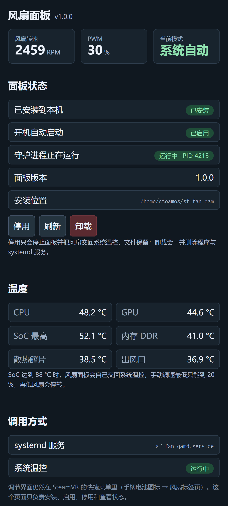

# Frame 风扇面板 · Framely 插件

把 [steam-frame-fan-panel](https://github.com/dhies23/steam-frame-fan-panel)（Steam Frame
快速设置菜单里的风扇 / 温度面板）接进 **Framely** 的插件体系：安装、启用、停用、卸载
全部在 Framely 的插件页里完成，页面上同时显示实时转速、PWM、手动 / 自动模式和温度。

> 这个插件**不重新实现风扇控制**。调速界面仍然是 SteamVR 快捷菜单里的一页
> （点底部栏的**电池图标** → 「?」右边的**风扇**标签）。Framely 页面只负责管理那套
> 程序的安装状态。

---

## 功能

| 页面上的操作 | 实际做的事 |
| --- | --- |
| **安装并启用** | 把守护进程 / 注入脚本装到 `/home/<steam 用户>/sf-fan-qam`，写 `sf-fan-qamd.service`，`enable --now`，然后核对进程真的起来了 |
| **启用** | `systemctl enable --now sf-fan-qamd.service` |
| **停用** | 停服务、关自启，并把风扇交回 `deckard-fan-control.service`（文件保留） |
| **卸载** | 停服务 → 删单元与程序目录 → 启动系统温控并确认它真的在跑 |
| 实时读数 | 每 1.5 秒刷新转速、PWM、模式与 6 路温度 |

页面还会显示三个状态：**已安装到本机** / **开机自动启动** / **守护进程正在运行**。



---

## 为什么后端要以 root 运行

守护进程直接写 `/sys/class/hwmon/slg4ax46073v/pwm1`，并且需要临时停掉
`deckard-fan-control.service` 才能接管风扇。这两件事都必须 root。
插件页本身不需要任何额外权限。

**任何一条失败路径都会把风扇交回系统温控**：安装或启用失败会回滚并重启
`deckard-fan-control.service`；卸载结束前会断言系统温控处于 active；后端崩溃时
`onCrashCleanup` 也会检查一遍。

---

## 安装

在 Framely 的插件页里找到「Frame 风扇面板」→ 安装 → 打开插件页 → 点「安装并启用」。

也可以直接装离线包：

```bash
sudo framely install dhies23.frame-fan-panel-1.0.0-preview.1.framely --approve --approve-run-as
```

### 兼容性

* 需要 Steam Frame（Deckard）开发机，风扇 hwmon 名为 `slg4ax46073v`。
  不是这台机器时插件只读、不改任何东西，页面会直接说明原因。
* 实机验证于 Framely `0.7.0-preview.2`。
* 只用 Python 3 标准库，不联网，不装额外依赖。

因为后端要 root 权限，Framely 在安装时会要求确认它以 root 运行
（命令行是 `--approve-run-as`）。

### 和独立安装包共存

插件使用的路径、服务名与独立安装包（`steam-frame-fan-panel` 的 `install.sh`）
完全一致，所以：

* 已经用 `install.sh` 装过的机器，插件页面会直接显示「已安装 / 已启用」；
* 插件的「卸载」和独立包的 `uninstall.sh` 可以互相清理对方装的东西。

---

## 构建与发布

```bash
npm install
npm run typecheck
npm run build          # 生成 payload/
python3 scripts/icon.py
python3 scripts/pack.py  # 生成 dist/*.framely 与 dist/SHA256SUMS
```

风扇面板本身只有一份源码（在 `dhies23/steam-frame-fan-panel` 里）。这个仓库把它的
发布文件**原样快照**在 `vendor/fan-panel/`，所以打 release 时不依赖任何外部目录，
CI 也不需要额外 checkout。改完风扇面板后同步一次：

```bash
node scripts/sync-panel.mjs
# 或者：FAN_PANEL_SOURCE=/path/to/sf-fan-qam node scripts/sync-panel.mjs
```

它会重写 `vendor/fan-panel/VENDOR.json`（记录版本与每个文件的 SHA256），
`tests/test_manifest.py` 会校验快照没有被改动。
临时想直接从工作副本构建，也可以用 `FAN_PANEL_SOURCE=/path/to/sf-fan-qam npm run build`。

推一个 `v<manifest.version>` 的 tag 就会触发
[`.github/workflows/release.yml`](.github/workflows/release.yml)，在 `ubuntu-24.04-arm`
上构建并发布 `.framely` 与 `SHA256SUMS`。

登记到插件数据库：

```bash
python3 scripts/submit_database.py v1.0.0-preview.1
```

版本号里带 `-preview.N` 会进 `testing` 渠道，普通 semver 进 `main`。

---

## 许可证

GPL-3.0-only，与上游风扇面板一致。见 [LICENSE](LICENSE)。
